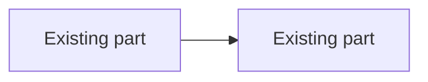
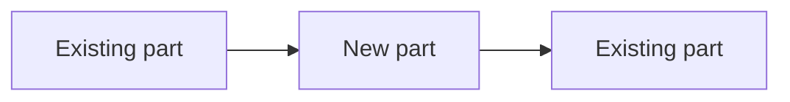

# Plan Template

Fill each section in order. Keep each heading. Replace each `<...>` slot. An empty section says why.

````markdown
---
kind: plan
title: <Feature name>
repo: <repo directory name>
date: YYYY-MM-DD
status: draft
spec: <path to the design doc or spec>
base: <the branch that the user or the spec names, else the origin/HEAD branch>
phases:
  - id: P1
    title: <Scaffold and check harness>
    files:
      - {path: "<path/to/file.py>", change: new}
  - id: P2
    title: <Phase title>
    files:
      - {path: "<path/to/other.py>", change: modified}
---

# <Feature name> plan

**Goal:** <one sentence>.
**Spec:** `<path>`.
**Base branch:** `<branch>`. Source: <the user, the spec, or `git symbolic-ref refs/remotes/origin/HEAD`>.
**Required skills:** <the skills that this plan needs, for example `build`, `tdd`, `data-op`, `staging`, and what each one runs>.
**Test card:** `~/dotfiles/ai/test-cards/<repo>.md`.
**Full suite:** `<command>`. It runs once, in the last phase.

## Global constraints

- <A project-wide rule from the spec, one line, with the exact value copied.>

## Before -> After

### Before


### After


## Entry points

- <HTTP route, event, job, test endpoint, or consumer>: `<path:line>`. <What reaches the change through it.>

## Domain model

- `<Type, table, or state machine>` in `<path>`: `<signature or fields>`.

## Failure modes

| Write path | Mode | What happens | Owner phase | Test that pins it |
|---|---|---|---|---|
| <path> | Transaction scope | <what commits together, what does not> | P<n> | `<test id>` |
| <path> | Side effect before commit | <event, HTTP call, or file written before the commit> | P<n> | `<test id>` |
| <path> | Retry | <what a second run does> | P<n> | `<test id>` |
| <path> | Idempotency | <the key or the state check> | P<n> | `<test id>` |
| <path> | Shared state | <row, file, key, or branch that two actors write, and how the plan removes the sharing> | P<n> | `<test id>` |
| <path or input> | <Other input or failure that the spec implies> | <what happens> | P<n> | `<test id>` |

## Phase 1: <Scaffold and check harness>

**Blocked by:** none.
**Touched tests:** `<command for this phase only>`.

**File**: `<path/to/file.py>`

**Interfaces:**
- Consumes: <names and signatures from earlier phases, or none>.
- Produces: <names, parameters, and return types that later phases use>.

- [ ] **Step 1: Baseline.** Run `<check>` on the code before the change. Record the value: `<value>`.
- [ ] **Step 2: Write the failing test** `<test id>`. Assert `<exact value from the spec>`.
- [ ] **Step 3: Run it.** Expected: FAIL with `<the predicted mismatch>`, not an import, collection, or missing-file error.
- [ ] **Step 4: Implement** `<name>(<params>) -> <type>` in `<path>`.
- [ ] **Step 5: Run the touched tests.** Expected: PASS.
- [ ] **Step 6: Commit** with message `<message>`.

#### Automated verification
- [ ] `<touched-test command>` passes.

#### Manual verification
- [ ] <A check that only a person or a live run can do, or "None." with the reason.>

## Phase 2: <Phase title>

**Blocked by:** P1.
**Touched tests:** `<command>`.

**File**: `<path/to/other.py>`

<Same blocks as Phase 1. The last phase also runs the full suite once.>
````

## Manifest rules

Grimoire renders the plan from the manifest and flags each drift. `plan-lint` prints each drift as one line.

- Each phase has `## Phase N: <title>`, and its id in the manifest is `PN`. Keep a title to about 40 characters.
- Each `**File**:` line has one backticked path. Write the colon after the bold marks, as in the template.
- Each `**File**:` path in a phase is in that phase's manifest `files`, and each manifest path is in the body. A file that two phases change is in both.
- `change` is `new`, `modified`, or `deleted`. `status` is `draft`, `approved`, `in-progress`, or `done`.
- Paths are relative to the repo. A file in another repo starts with `~/`.
- `## Before -> After` holds `### Before` and `### After`, each with one mermaid block. Each diagram shows only the parts that the plan touches, at most about 12 nodes. A new part is only in After. A removed part is only in Before. Use `flowchart LR`, quote each label, and do not start a label with `/`.
- The file starts with the `---` line. With text before it, Grimoire does not read the manifest and does not check it. `plan-lint` exits 1 for this, and for a frontmatter without `kind: plan`.
- The manifest `files` list of a phase is the file set that it owns. Two parallel phases do not share a path.

## Step rules

`plan-lint` checks each checkbox step. Each rule below is one line of its output when the step breaks it.

- Write each step as `- [ ] **Step N: <title>**`.
- A test step writes or changes a test. `plan-lint` finds it by its title (Write or Add with test, or the word test or tests) or by a sentence that starts with Test. Name each test in backticks, for example `test_parse_limit`. Give a literal expected value in backticks, for example `parse_limit("5") == 5`.
- A code step writes or changes code. `plan-lint` finds it by an Implement title, by a source file in backticks (`.py`, `.sh`, `.js`, `.ts`, `.go`, `.rs`, `.nix`) or by a fenced `def`, `func` or `class`. Give the signature in backticks as `name(params) -> type`. Give the file path in backticks.
- A prose edit (only `.md` or other non-source files) is not a code step. Do not give it a signature.
- A verification step gives the command and the output that means it passed.

## Self-review

Do these checks after you write the plan. Fix each gap in the plan. Do not review again.

1. **Spec coverage.** For each requirement in the spec, point to its phase. Add a phase for each requirement with none.
2. **Step scan.** Each step lets the builder write exactly one reasonable thing. Fix a line that decides nothing. Cut a body that the signature and the tests already fix.
3. **Name match.** Each name, type, and signature in a later phase matches its first use in an earlier phase.
4. **Failure modes.** Each row in Failure modes has an owner phase and a test in that phase.
5. **Proportion.** A plan that is much longer than the spec is a copy of the code. Replace bodies with signatures, test names, and assertions.
