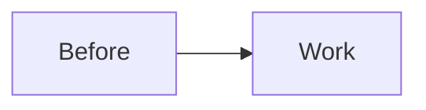
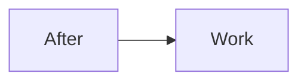

# Fixture plan with defects

## Phase 1: First phase

**File**: ai/example/bare.py
**File**: `ai/example/edited.py`

#### Automated verification
- [ ] `python3 -m unittest` passes.

## Before → After

### Before

### After

