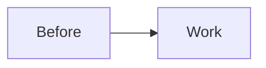

# Fixture plan

## Phase 1: Only phase

**File**: `ai/example/one.py`

- [ ] **Step 1: Write the failing test.** Check that the limit parses.
- [ ] **Step 2: Write tests:** `test_in_sync`, `test_staging_behind`.
- [ ] **Step 3: Implement** the parser in `ai/example/one.py`.
- [ ] **Step 4: Implement** `parse_limit(raw: str) -> int`.
- [ ] **Step 5: Run** the tests. Expected: PASS.

#### Automated verification
- [ ] `python3 -m unittest` passes.

## Before → After

### Before

### After

