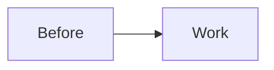
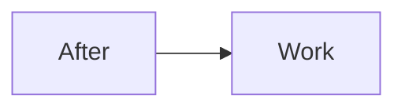

# Fixture plan

## Phase 1: Only phase

**File**: `ai/example/one.py`

- [ ] **Step 1: Baseline.** Run `wc -l ai/example/one.py`. Record the value.
- [ ] **Step 2: Write the failing test** `test_parse_limit`. Assert `parse_limit("5") == 5`.
- [ ] **Step 3: Write the failing tests** in `ai/tests/test_one.py`:
  - `test_empty_input`: `parse_limit("")` raises `ValueError`.
  - `test_upper_bound`: input 101 gives 100.
- [ ] **Step 4: Write the failing test**

```python
def test_default_limit():
    assert parse_limit(None) == 10
```

- [ ] **Step 5: Run it.** Expected: FAIL with `assert 0 == 5`.
- [ ] **Step 6: Implement** `parse_limit(raw: str | None) -> int` in `ai/example/one.py`.
- [ ] **Step 7: Implement** in `ai/example/one.py`:

```python
def clamp(value: int, high: int) -> int:
```

- [ ] **Step 8: Write the four test cards.** Each card has a prerequisites line.
- [ ] Write the failing test `test_zero`. Assert `parse_limit("0") == 0`.
- [ ] **Step 9: Commit** with message `one: parse the limit`.

#### Automated verification
- [ ] `python3 -m unittest` passes.

## Before → After

### Before



### After


